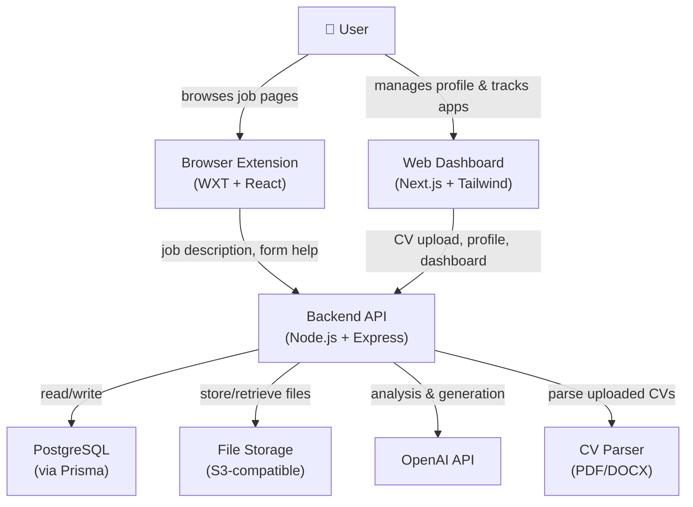
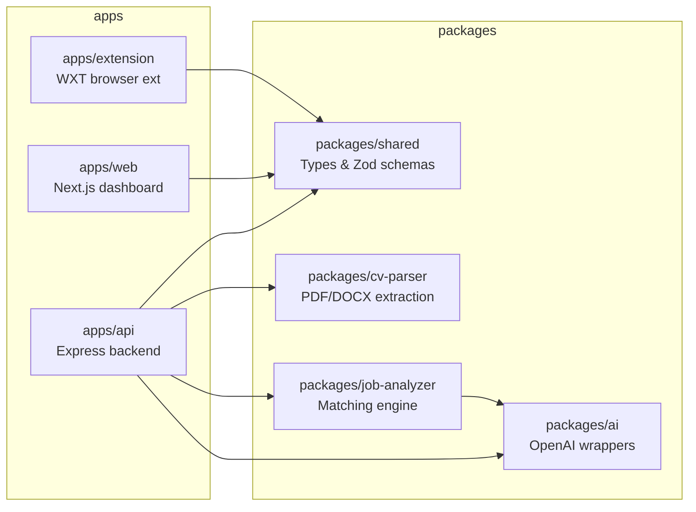
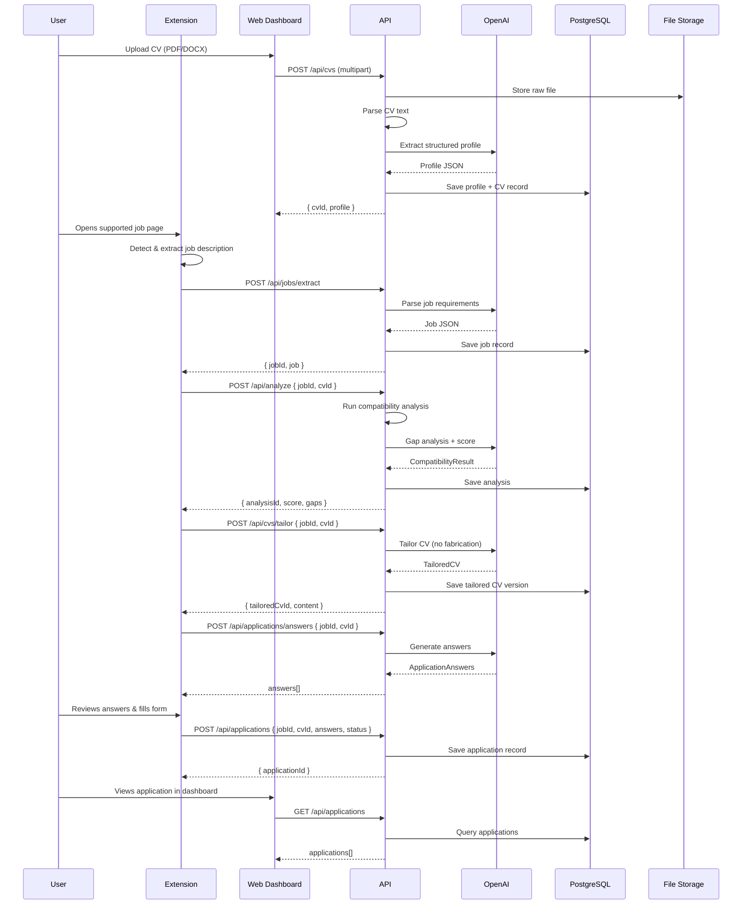

# Design Document: ApplyFlow MVP

## Overview

ApplyFlow is a hybrid AI job application assistant composed of three tightly integrated components: a browser extension, a web dashboard, and a backend API. Together they automate and streamline the end-to-end job application process — from CV upload and job detection through compatibility analysis, tailored CV generation, application form assistance, and application tracking.

The MVP delivers one complete vertical slice: a user uploads their CV, browses to a supported job listing, receives an AI-powered compatibility analysis and a tailored CV, gets suggested answers for application questions, fills the form with extension assistance, and finds the full application record saved in their dashboard.

The system is built entirely in TypeScript across a pnpm + Turborepo monorepo. The backend uses Node.js + Express with PostgreSQL via Prisma. AI features run through the OpenAI API. File storage is S3-compatible. Authentication uses JWT (with Auth.js as an option). The browser extension is built with WXT + React.

---

## Architecture

### System Context



### Monorepo Package Map



### Request Flow — End-to-End MVP



---

## Components and Interfaces

### Component 1: Browser Extension (`apps/extension`)

**Purpose**: Detect supported job pages, extract job descriptions, present AI-generated content to the user, and assist with form filling.

**Interface**:
```typescript
// Content script injected into job pages
interface JobPageAdapter {
  isSupported(url: string): boolean
  extractJobDescription(): JobDescriptionRaw
  detectFormFields(): FormField[]
  fillFormField(fieldId: string, value: string): void
}

// Background service worker
interface ExtensionBackgroundService {
  getAuthToken(): Promise<string | null>
  callAPI<T>(endpoint: string, body: unknown): Promise<T>
  getCurrentJob(): Promise<Job | null>
}

// Extension UI state (React, via Zustand or React Context)
interface ExtensionUIState {
  status: 'idle' | 'detecting' | 'analyzing' | 'ready' | 'error'
  job: Job | null
  analysis: CompatibilityAnalysis | null
  tailoredCv: TailoredCV | null
  answers: ApplicationAnswer[]
  selectedCvId: string | null
}
```

**Responsibilities**:
- Inject content scripts on matching job board URLs
- Extract job title, description, requirements, and company from page DOM
- Communicate with background service worker via Chrome message passing
- Render side-panel UI with analysis results and form-fill controls
- Handle authentication state (redirect to dashboard login if unauthenticated)

**Supported job boards (MVP)**:
- LinkedIn Jobs (`linkedin.com/jobs/*`)
- Indeed (`indeed.com/viewjob*`)
- Greenhouse (`boards.greenhouse.io/*`)

---

### Component 2: Web Dashboard (`apps/web`)

**Purpose**: Allow users to manage their profile, upload CVs, browse saved jobs, view analysis results, and track applications.

**Interface**:
```typescript
// Next.js route handlers (App Router)
interface DashboardRoutes {
  'GET /dashboard': () => DashboardPage
  'GET /profile': () => ProfilePage
  'GET /cvs': () => CVListPage
  'GET /jobs': () => JobListPage
  'GET /applications': () => ApplicationListPage
  'GET /applications/[id]': (id: string) => ApplicationDetailPage
}

// API client (used by dashboard pages)
interface APIClient {
  uploadCV(file: File): Promise<CV>
  getProfile(): Promise<UserProfile>
  updateProfile(data: Partial<UserProfile>): Promise<UserProfile>
  getJobs(filters?: JobFilter): Promise<PaginatedResult<Job>>
  getApplications(filters?: ApplicationFilter): Promise<PaginatedResult<Application>>
  getApplication(id: string): Promise<ApplicationDetail>
}
```

**Responsibilities**:
- Provide authenticated Next.js pages for all dashboard features
- Handle CV file upload with progress indication
- Display compatibility scores and gap analysis visually
- Show tailored CV diffs compared to original
- Present and allow editing of AI-generated application answers
- Render application timeline and status tracking

---

### Component 3: Backend API (`apps/api`)

**Purpose**: Central orchestrator — handles authentication, file storage, AI coordination, and all data persistence.

**Interface**:
```typescript
// Express router groups
interface APIRouterGroups {
  auth:         '/api/auth/*'
  cvs:          '/api/cvs/*'
  jobs:         '/api/jobs/*'
  applications: '/api/applications/*'
  profile:      '/api/profile/*'
}

// Core service interfaces
interface CVService {
  upload(userId: string, file: Buffer, mimeType: string): Promise<CV>
  parse(cvId: string): Promise<ParsedCVProfile>
  tailor(cvId: string, jobId: string): Promise<TailoredCV>
  getById(cvId: string, userId: string): Promise<CV>
}

interface JobService {
  extractFromDescription(raw: string, sourceUrl: string): Promise<Job>
  getById(jobId: string): Promise<Job>
  listByUser(userId: string, filters?: JobFilter): Promise<PaginatedResult<Job>>
}

interface AnalysisService {
  analyze(cvId: string, jobId: string, userId: string): Promise<CompatibilityAnalysis>
  getById(analysisId: string): Promise<CompatibilityAnalysis>
}

interface ApplicationService {
  generateAnswers(jobId: string, cvId: string, userId: string): Promise<ApplicationAnswer[]>
  create(data: CreateApplicationInput): Promise<Application>
  updateStatus(applicationId: string, status: ApplicationStatus, userId: string): Promise<Application>
  listByUser(userId: string, filters?: ApplicationFilter): Promise<PaginatedResult<Application>>
}
```

---

### Component 4: Shared Package (`packages/shared`)

**Purpose**: Single source of truth for TypeScript types, Zod validation schemas, and API contract types used across all apps.

```typescript
// packages/shared/src/index.ts (barrel export)
export * from './types/cv'
export * from './types/job'
export * from './types/analysis'
export * from './types/application'
export * from './types/user'
export * from './schemas/cv'
export * from './schemas/job'
export * from './schemas/application'
export * from './api/contracts'
```

---

### Component 5: AI Package (`packages/ai`)

**Purpose**: Encapsulate all OpenAI API calls with typed prompt templates, retry logic, and cost tracking.

```typescript
interface AIClient {
  extractCVProfile(rawText: string): Promise<ParsedCVProfile>
  extractJobRequirements(rawDescription: string): Promise<JobRequirements>
  analyzeCompatibility(profile: ParsedCVProfile, job: JobRequirements): Promise<CompatibilityResult>
  tailorCV(profile: ParsedCVProfile, job: JobRequirements): Promise<TailoredCVContent>
  generateAnswers(profile: ParsedCVProfile, job: JobRequirements, questions: string[]): Promise<ApplicationAnswer[]>
}
```

---

### Component 6: CV Parser Package (`packages/cv-parser`)

**Purpose**: Extract plain text from uploaded PDF and DOCX files.

```typescript
interface CVParser {
  parse(buffer: Buffer, mimeType: 'application/pdf' | 'application/vnd.openxmlformats-officedocument.wordprocessingml.document'): Promise<string>
}
```

---

### Component 7: Job Analyzer Package (`packages/job-analyzer`)

**Purpose**: Core matching logic — scoring, gap identification, and tailoring constraints.

```typescript
interface JobAnalyzer {
  score(profile: ParsedCVProfile, requirements: JobRequirements): CompatibilityScore
  identifyGaps(profile: ParsedCVProfile, requirements: JobRequirements): SkillGap[]
  buildTailoringConstraints(profile: ParsedCVProfile, gaps: SkillGap[]): TailoringConstraints
}
```

---

## Data Models

### User

```typescript
interface User {
  id: string            // UUID
  email: string
  passwordHash: string
  createdAt: Date
  updatedAt: Date
}
```

### UserProfile

```typescript
interface UserProfile {
  id: string
  userId: string
  fullName: string
  headline: string | null
  location: string | null
  linkedinUrl: string | null
  githubUrl: string | null
  portfolioUrl: string | null
  updatedAt: Date
}
```

### CV

```typescript
interface CV {
  id: string
  userId: string
  filename: string
  storageKey: string        // S3 object key
  mimeType: 'application/pdf' | 'application/vnd.openxmlformats-officedocument.wordprocessingml.document'
  parsedText: string | null
  parsedProfile: ParsedCVProfile | null  // JSONB
  isActive: boolean
  createdAt: Date
}

interface ParsedCVProfile {
  fullName: string
  email: string | null
  phone: string | null
  location: string | null
  summary: string | null
  skills: string[]
  languages: string[]
  education: EducationEntry[]
  experience: ExperienceEntry[]
  projects: ProjectEntry[]
  certifications: string[]
}

interface EducationEntry {
  institution: string
  degree: string
  field: string | null
  startYear: number | null
  endYear: number | null
  gpa: string | null
}

interface ExperienceEntry {
  company: string
  title: string
  location: string | null
  startDate: string    // ISO 8601
  endDate: string | null
  current: boolean
  bullets: string[]    // accomplishment statements
}

interface ProjectEntry {
  name: string
  description: string
  technologies: string[]
  url: string | null
}
```

### Job

```typescript
interface Job {
  id: string
  userId: string
  sourceUrl: string
  platform: 'linkedin' | 'indeed' | 'greenhouse' | 'manual' | 'unknown'
  title: string
  company: string
  location: string | null
  remote: boolean
  rawDescription: string
  requirements: JobRequirements | null   // JSONB
  createdAt: Date
}

interface JobRequirements {
  requiredSkills: string[]
  preferredSkills: string[]
  requiredYearsExperience: number | null
  requiredEducation: string | null
  responsibilities: string[]
  niceToHave: string[]
  keywords: string[]
}
```

### CompatibilityAnalysis

```typescript
interface CompatibilityAnalysis {
  id: string
  userId: string
  cvId: string
  jobId: string
  score: number          // 0–100
  scoreBreakdown: ScoreBreakdown
  gaps: SkillGap[]
  strengths: string[]
  recommendations: string[]
  createdAt: Date
}

interface ScoreBreakdown {
  skills: number          // 0–100
  experience: number      // 0–100
  education: number       // 0–100
  keywords: number        // 0–100
}

interface SkillGap {
  skill: string
  required: boolean       // true = required, false = preferred
  severity: 'low' | 'medium' | 'high'
}
```

### TailoredCV

```typescript
interface TailoredCV {
  id: string
  userId: string
  baseCvId: string
  jobId: string
  analysisId: string
  content: TailoredCVContent   // JSONB
  storageKey: string | null    // rendered PDF key
  createdAt: Date
}

interface TailoredCVContent {
  summary: string              // rewritten summary
  skills: string[]             // reordered/filtered skills
  experience: ExperienceEntry[] // bullets rewritten for job keywords
  projects: ProjectEntry[]      // most relevant projects
  education: EducationEntry[]
  changeLog: CVChange[]        // audit of what changed and why
}

interface CVChange {
  section: 'summary' | 'skills' | 'experience' | 'projects'
  changeType: 'reorder' | 'rewrite' | 'omit' | 'emphasize'
  rationale: string
}
```

### Application

```typescript
type ApplicationStatus = 'draft' | 'submitted' | 'interviewing' | 'offered' | 'rejected' | 'withdrawn'

interface Application {
  id: string
  userId: string
  jobId: string
  cvId: string
  tailoredCvId: string | null
  analysisId: string | null
  status: ApplicationStatus
  answers: ApplicationAnswer[]   // JSONB
  submittedAt: Date | null
  createdAt: Date
  updatedAt: Date
}

interface ApplicationAnswer {
  question: string
  answer: string
  source: 'ai-generated' | 'user-edited' | 'user-written'
}
```

---

## Prisma Schema (Abbreviated)

```prisma
model User {
  id           String   @id @default(uuid())
  email        String   @unique
  passwordHash String
  createdAt    DateTime @default(now())
  updatedAt    DateTime @updatedAt

  profile      UserProfile?
  cvs          CV[]
  jobs         Job[]
  analyses     CompatibilityAnalysis[]
  tailoredCvs  TailoredCV[]
  applications Application[]
}

model CV {
  id             String   @id @default(uuid())
  userId         String
  filename       String
  storageKey     String
  mimeType       String
  parsedText     String?
  parsedProfile  Json?
  isActive       Boolean  @default(false)
  createdAt      DateTime @default(now())

  user           User     @relation(fields: [userId], references: [id])
  analyses       CompatibilityAnalysis[]
  tailoredCvs    TailoredCV[]
  applications   Application[]
}

model Job {
  id             String   @id @default(uuid())
  userId         String
  sourceUrl      String
  platform       String
  title          String
  company        String
  location       String?
  remote         Boolean  @default(false)
  rawDescription String
  requirements   Json?
  createdAt      DateTime @default(now())

  user           User     @relation(fields: [userId], references: [id])
  analyses       CompatibilityAnalysis[]
  tailoredCvs    TailoredCV[]
  applications   Application[]
}

model CompatibilityAnalysis {
  id            String   @id @default(uuid())
  userId        String
  cvId          String
  jobId         String
  score         Int
  scoreBreakdown Json
  gaps          Json
  strengths     Json
  recommendations Json
  createdAt     DateTime @default(now())

  user          User @relation(fields: [userId], references: [id])
  cv            CV   @relation(fields: [cvId], references: [id])
  job           Job  @relation(fields: [jobId], references: [id])
}

model TailoredCV {
  id          String   @id @default(uuid())
  userId      String
  baseCvId    String
  jobId       String
  analysisId  String
  content     Json
  storageKey  String?
  createdAt   DateTime @default(now())

  user        User @relation(fields: [userId], references: [id])
  cv          CV   @relation(fields: [baseCvId], references: [id])
  job         Job  @relation(fields: [jobId], references: [id])
}

model Application {
  id            String   @id @default(uuid())
  userId        String
  jobId         String
  cvId          String
  tailoredCvId  String?
  analysisId    String?
  status        String   @default("draft")
  answers       Json     @default("[]")
  submittedAt   DateTime?
  createdAt     DateTime @default(now())
  updatedAt     DateTime @updatedAt

  user          User @relation(fields: [userId], references: [id])
  job           Job  @relation(fields: [jobId], references: [id])
  cv            CV   @relation(fields: [cvId], references: [id])
}
```

---

## Algorithmic Pseudocode

### Algorithm 1: CV Upload and Profile Extraction

```typescript
async function uploadAndParseCVProfile(
  userId: string,
  fileBuffer: Buffer,
  filename: string,
  mimeType: SupportedMimeType
): Promise<CV>
```

**Preconditions:**
- `fileBuffer` is non-empty and does not exceed 10 MB
- `mimeType` is `'application/pdf'` or the DOCX MIME type
- `userId` refers to an existing authenticated user

**Postconditions:**
- Raw file is stored in S3 under key `cvs/{userId}/{cvId}/{filename}`
- A `CV` record is persisted in the database with `parsedProfile` populated
- Returns the created `CV` with `parsedProfile` set

**Algorithm:**

```pascal
ALGORITHM uploadAndParseCVProfile(userId, fileBuffer, filename, mimeType)

  ASSERT fileBuffer.length > 0 AND fileBuffer.length <= 10_485_760
  ASSERT mimeType IN ['application/pdf', DOCX_MIME]

  cvId ← generateUUID()
  storageKey ← "cvs/" + userId + "/" + cvId + "/" + filename

  // Step 1: Store raw file
  AWAIT s3.putObject(storageKey, fileBuffer, mimeType)

  // Step 2: Extract plain text
  rawText ← AWAIT cvParser.parse(fileBuffer, mimeType)
  ASSERT rawText.length > 0

  // Step 3: AI extraction with retry
  attempts ← 0
  profile ← null
  WHILE attempts < 3 AND profile = null DO
    TRY
      profile ← AWAIT aiClient.extractCVProfile(rawText)
    CATCH RateLimitError
      AWAIT sleep(2^attempts * 1000ms)
      attempts ← attempts + 1
    CATCH ValidationError AS e
      THROW ParseError("AI returned invalid profile schema: " + e.message)
  END WHILE

  IF profile = null THEN
    THROW ExtractionError("CV extraction failed after 3 attempts")
  END IF

  // Step 4: Persist
  cv ← AWAIT db.cv.create({
    id: cvId, userId, filename, storageKey,
    mimeType, parsedText: rawText, parsedProfile: profile,
    isActive: false
  })

  RETURN cv
END
```

**Loop Invariant**: On each retry iteration, `attempts` increases by 1 and `profile` remains null until a successful extraction.

---

### Algorithm 2: Job Description Extraction

```typescript
async function extractJobFromDescription(
  rawDescription: string,
  sourceUrl: string,
  userId: string
): Promise<Job>
```

**Preconditions:**
- `rawDescription` length is between 100 and 50,000 characters
- `sourceUrl` is a valid URL string

**Postconditions:**
- Returns a `Job` record with `requirements` populated
- Job is persisted in the database associated with `userId`

**Algorithm:**

```pascal
ALGORITHM extractJobFromDescription(rawDescription, sourceUrl, userId)

  ASSERT rawDescription.length >= 100 AND rawDescription.length <= 50_000

  platform ← detectPlatform(sourceUrl)
  // platform ∈ { 'linkedin', 'indeed', 'greenhouse', 'manual', 'unknown' }

  requirements ← AWAIT aiClient.extractJobRequirements(rawDescription)

  job ← AWAIT db.job.create({
    id: generateUUID(),
    userId,
    sourceUrl,
    platform,
    title: requirements.inferredTitle,
    company: requirements.inferredCompany,
    rawDescription,
    requirements
  })

  RETURN job
END

FUNCTION detectPlatform(url: string): Platform
  IF url CONTAINS "linkedin.com" THEN RETURN 'linkedin'
  IF url CONTAINS "indeed.com"   THEN RETURN 'indeed'
  IF url CONTAINS "greenhouse.io" THEN RETURN 'greenhouse'
  RETURN 'unknown'
END
```

---

### Algorithm 3: Compatibility Analysis

```typescript
async function runCompatibilityAnalysis(
  cvId: string,
  jobId: string,
  userId: string
): Promise<CompatibilityAnalysis>
```

**Preconditions:**
- `cv.parsedProfile` is non-null
- `job.requirements` is non-null
- Both `cvId` and `jobId` belong to `userId`

**Postconditions:**
- Returns `CompatibilityAnalysis` with `score` in [0, 100]
- `gaps` contains only skills present in `job.requirements` but absent from `cv.parsedProfile`

**Algorithm:**

```pascal
ALGORITHM runCompatibilityAnalysis(cvId, jobId, userId)

  cv  ← AWAIT db.cv.findUnique(cvId)
  job ← AWAIT db.job.findUnique(jobId)

  ASSERT cv.userId = userId AND job.userId = userId
  ASSERT cv.parsedProfile ≠ null AND job.requirements ≠ null

  profile      ← cv.parsedProfile
  requirements ← job.requirements

  // Local scoring (deterministic, fast)
  scoreBreakdown ← jobAnalyzer.score(profile, requirements)
  gaps           ← jobAnalyzer.identifyGaps(profile, requirements)

  // AI enrichment for qualitative fields
  aiResult ← AWAIT aiClient.analyzeCompatibility(profile, requirements)

  overallScore ← weightedAverage(
    scoreBreakdown.skills     * 0.40,
    scoreBreakdown.experience * 0.30,
    scoreBreakdown.education  * 0.15,
    scoreBreakdown.keywords   * 0.15
  )

  ASSERT overallScore >= 0 AND overallScore <= 100

  analysis ← AWAIT db.compatibilityAnalysis.create({
    id: generateUUID(), userId, cvId, jobId,
    score: round(overallScore),
    scoreBreakdown,
    gaps,
    strengths: aiResult.strengths,
    recommendations: aiResult.recommendations
  })

  RETURN analysis
END
```

**Loop Invariant**: N/A (no loops; deterministic scoring is a pure function over the profile and requirements).

---

### Algorithm 4: CV Tailoring (No Fabrication Guarantee)

```typescript
async function tailorCV(
  cvId: string,
  jobId: string,
  analysisId: string,
  userId: string
): Promise<TailoredCV>
```

**Preconditions:**
- `cv.parsedProfile` is non-null
- `analysis` exists for `(cvId, jobId)`
- All content in the tailored output must be derivable from `cv.parsedProfile`

**Postconditions:**
- Every bullet in the tailored experience section appears in or is a rephrasing of an original bullet
- No new skills, companies, roles, or dates are introduced
- `changeLog` documents every modification with rationale

**Algorithm:**

```pascal
ALGORITHM tailorCV(cvId, jobId, analysisId, userId)

  cv       ← AWAIT db.cv.findUnique(cvId)
  job      ← AWAIT db.job.findUnique(jobId)
  analysis ← AWAIT db.compatibilityAnalysis.findUnique(analysisId)

  ASSERT cv.userId = userId
  ASSERT cv.parsedProfile ≠ null AND job.requirements ≠ null

  constraints ← jobAnalyzer.buildTailoringConstraints(cv.parsedProfile, analysis.gaps)
  // constraints.forbiddenAdditions = set of skills/experiences not in original profile
  // constraints.emphasize          = skills matching job requirements
  // constraints.deprioritize       = skills irrelevant to this job

  systemPrompt ← buildTailoringSystemPrompt(constraints)
  // System prompt explicitly states:
  //   "You MUST NOT add any skill, company, role, degree, or date not present in the original profile.
  //    You MAY reorder, rephrase, emphasize, or omit. Every change MUST be logged in changeLog."

  rawContent ← AWAIT aiClient.tailorCV(cv.parsedProfile, job.requirements, systemPrompt)

  // Validate no fabrication occurred
  CALL validateNoFabrication(rawContent, cv.parsedProfile)
  // Throws FabricationError if new entities detected

  tailored ← AWAIT db.tailoredCV.create({
    id: generateUUID(), userId, baseCvId: cvId,
    jobId, analysisId, content: rawContent
  })

  RETURN tailored
END

FUNCTION validateNoFabrication(tailored: TailoredCVContent, original: ParsedCVProfile): void
  FOR each exp IN tailored.experience DO
    IF NOT original.experience.some(o => o.company = exp.company AND o.title = exp.title) THEN
      THROW FabricationError("New job entry detected: " + exp.company)
    END IF
  END FOR

  FOR each skill IN tailored.skills DO
    IF NOT original.skills.includes(skill) THEN
      THROW FabricationError("New skill detected: " + skill)
    END IF
  END FOR
END
```

**Loop Invariant**: For each validated entry, all previously checked entries are confirmed to exist in the original profile.

---

### Algorithm 5: Application Answer Generation

```typescript
async function generateApplicationAnswers(
  jobId: string,
  cvId: string,
  questions: string[],
  userId: string
): Promise<ApplicationAnswer[]>
```

**Preconditions:**
- `questions` is a non-empty array of non-empty strings
- `cv.parsedProfile` is non-null

**Postconditions:**
- Returns one `ApplicationAnswer` per question
- Each answer references only content derivable from the user's profile or previous answers
- All answers are marked `source: 'ai-generated'`

**Algorithm:**

```pascal
ALGORITHM generateApplicationAnswers(jobId, cvId, questions, userId)

  ASSERT questions.length > 0
  ASSERT FORALL q IN questions: q.trim().length > 0

  cv  ← AWAIT db.cv.findUnique(cvId)
  job ← AWAIT db.job.findUnique(jobId)

  ASSERT cv.userId = userId

  // Retrieve prior answers for consistency
  priorAnswers ← AWAIT db.application
    .findMany({ where: { userId, jobId: { not: jobId } }, select: { answers: true } })
    .flatMap(a => a.answers)
    .slice(-20)   // last 20 answers for context

  answers ← AWAIT aiClient.generateAnswers(
    cv.parsedProfile,
    job.requirements,
    questions,
    priorAnswers  // consistency context
  )

  ASSERT answers.length = questions.length

  RETURN answers.map((a, i) => ({
    question: questions[i],
    answer: a,
    source: 'ai-generated'
  }))
END
```

---

### Algorithm 6: Local Compatibility Scoring

```typescript
function scoreCompatibility(
  profile: ParsedCVProfile,
  requirements: JobRequirements
): ScoreBreakdown
```

**Preconditions:**
- Both `profile` and `requirements` are non-null

**Postconditions:**
- All scores in `ScoreBreakdown` are in [0, 100]
- `skills` score is 100 if all required skills are present in the profile

**Algorithm:**

```pascal
FUNCTION scoreCompatibility(profile, requirements): ScoreBreakdown

  // Skills score
  requiredMatches ← 0
  FOR each skill IN requirements.requiredSkills DO
    IF normalizedMatch(skill, profile.skills) THEN
      requiredMatches ← requiredMatches + 1
    END IF
  END FOR
  // Loop invariant: requiredMatches ≤ |requirements.requiredSkills|

  skillsScore ← IF requirements.requiredSkills.length = 0
    THEN 100
    ELSE floor((requiredMatches / requirements.requiredSkills.length) * 100)

  // Experience score
  totalMonths  ← sumExperienceMonths(profile.experience)
  requiredMonths ← (requirements.requiredYearsExperience ?? 0) * 12
  experienceScore ← IF requiredMonths = 0
    THEN 100
    ELSE min(100, floor((totalMonths / requiredMonths) * 100))

  // Education score (heuristic)
  educationScore ← matchEducation(profile.education, requirements.requiredEducation)

  // Keyword score
  descriptionText ← requirements.keywords.join(" ").toLowerCase()
  profileText     ← buildProfileText(profile).toLowerCase()
  keywordScore    ← computeKeywordOverlap(descriptionText, profileText)

  RETURN { skills: skillsScore, experience: experienceScore, education: educationScore, keywords: keywordScore }
END

FUNCTION normalizedMatch(required: string, profileSkills: string[]): boolean
  requiredNorm ← required.toLowerCase().trim()
  RETURN profileSkills.some(s => s.toLowerCase().trim() = requiredNorm
    OR levenshteinSimilarity(s.toLowerCase(), requiredNorm) >= 0.85)
END
```

---

## Key Functions with Formal Specifications

### `POST /api/cvs` — Upload CV

```typescript
async function handleCVUpload(req: AuthenticatedRequest, res: Response): Promise<void>
```

**Preconditions:**
- Request is authenticated (`req.userId` is set)
- `req.file` is present with valid MIME type
- File size ≤ 10 MB

**Postconditions:**
- Response status 201 with `{ cvId, profile }` on success
- Response status 400 if file is missing or type is invalid
- Response status 413 if file exceeds size limit
- S3 object is created before the database record

---

### `POST /api/jobs/extract` — Extract Job

```typescript
async function handleJobExtract(req: AuthenticatedRequest, res: Response): Promise<void>
```

**Preconditions:**
- `req.body.rawDescription` is a string with length in [100, 50000]
- `req.body.sourceUrl` is a non-empty string

**Postconditions:**
- Returns 201 with `{ jobId, job }` on success
- Deduplicates: if a job with the same `sourceUrl` and `userId` already exists within 24 hours, returns that record with status 200

---

### `POST /api/analyze` — Compatibility Analysis

```typescript
async function handleAnalyze(req: AuthenticatedRequest, res: Response): Promise<void>
```

**Preconditions:**
- `req.body.cvId` and `req.body.jobId` are valid UUIDs owned by `req.userId`
- Both CV and job have been fully parsed

**Postconditions:**
- Returns 201 with full `CompatibilityAnalysis` object
- Idempotent: re-requesting with the same `(cvId, jobId)` within 1 hour returns cached result

---

### `POST /api/cvs/tailor` — Tailor CV

```typescript
async function handleTailorCV(req: AuthenticatedRequest, res: Response): Promise<void>
```

**Preconditions:**
- Analysis exists for the given `(cvId, jobId)` pair
- `cv.parsedProfile` is non-null

**Postconditions:**
- Returns 201 with `TailoredCV`
- No experience, skill, education, or company not present in the original CV appears in the output
- `changeLog` is non-empty and covers all modified sections

---

### `POST /api/applications` — Save Application

```typescript
async function handleCreateApplication(req: AuthenticatedRequest, res: Response): Promise<void>
```

**Preconditions:**
- `req.body` passes `createApplicationSchema` Zod validation
- Referenced `jobId` and `cvId` belong to `req.userId`

**Postconditions:**
- Returns 201 with created `Application`
- `answers` array length equals number of answers provided
- `status` defaults to `'draft'`

---

## Error Handling

### Scenario 1: AI Service Unavailable

**Condition**: OpenAI API returns 429 (rate limit) or 5xx error.
**Response**: Retry with exponential backoff (up to 3 attempts, delays of 1s, 2s, 4s).
**Recovery**: After 3 failures, return 503 with `{ error: 'ai_unavailable', retryAfter: 30 }`.

### Scenario 2: CV Parse Failure

**Condition**: PDF/DOCX parser throws or returns empty text (corrupted file, unsupported version, scanned image).
**Response**: Return 422 with `{ error: 'cv_parse_failed', reason: 'empty_text' | 'parse_error' }`.
**Recovery**: User is prompted to try a different file format or copy-paste their CV text.

### Scenario 3: Fabrication Detected in Tailored CV

**Condition**: `validateNoFabrication` throws `FabricationError`.
**Response**: Log the incident with the offending content. Retry the tailoring call once with a stricter prompt.
**Recovery**: If the second attempt also fails validation, return 500 and do not persist the tailored CV.

### Scenario 4: Extension Not Authenticated

**Condition**: Extension background service finds no stored auth token or token is expired.
**Response**: Extension UI shows "Sign in to ApplyFlow" prompt with a link to the dashboard.
**Recovery**: User authenticates in the dashboard; extension picks up the new token from `chrome.storage.local`.

### Scenario 5: Unsupported Job Page

**Condition**: `JobPageAdapter.isSupported(url)` returns false.
**Response**: Extension renders an inactive state with "This job board is not yet supported."
**Recovery**: User can copy-paste the job description manually via the extension's manual input field.

### Scenario 6: S3 Storage Failure

**Condition**: S3 `putObject` call fails (network error, permissions, quota).
**Response**: Return 500. Do not create the database record (transaction is rolled back).
**Recovery**: File is not partially stored; user can retry the upload.

---

## Testing Strategy

### Unit Testing Approach

Each package exposes pure functions testable in isolation:
- `packages/job-analyzer`: `scoreCompatibility`, `identifyGaps`, `normalizedMatch` — test with fixtures of profiles and requirements, assert score ranges and gap content.
- `packages/cv-parser`: `parse` — test with sample PDF/DOCX buffers, assert non-empty text extraction.
- `packages/shared`: Zod schemas — assert valid inputs pass and invalid inputs throw with correct error paths.

**Framework**: Vitest (runs in both Node.js and browser contexts; compatible with the monorepo).

### Property-Based Testing Approach

**Property Test Library**: fast-check

Properties to verify:

1. **Score Bounds**: For any `ParsedCVProfile` and `JobRequirements`, `scoreCompatibility` always returns values in [0, 100] for all four sub-scores.

2. **Gap Subset Property**: Every gap returned by `identifyGaps` has its skill present in `requirements.requiredSkills` or `requirements.preferredSkills`, and absent from `profile.skills`.

3. **Fabrication-Free Tailoring Invariant**: The output of `validateNoFabrication` never throws when given the original profile as both input and tailored content (identity case).

4. **Answer Count Invariant**: `generateApplicationAnswers` always returns exactly `questions.length` answers.

5. **Job Deduplication Idempotency**: Calling `extractJobFromDescription` twice with the same `(sourceUrl, userId)` within 24 hours returns the same `jobId`.

### Integration Testing Approach

- Spin up a test PostgreSQL database using Docker Compose.
- Run end-to-end API tests against the Express server with a mocked OpenAI client.
- Test the full MVP flow: upload CV → extract job → analyze → tailor → save application.
- Assert database state after each step (record counts, field values).

---

## Performance Considerations

- **CV parsing** is synchronous and CPU-bound. For files > 2 MB, offload to a worker thread (`worker_threads`) to avoid blocking the event loop.
- **OpenAI calls** are the dominant latency source (1–10 seconds). The extension should show a streaming progress indicator. Where possible, cache analysis results for `(cvId, jobId)` pairs for 1 hour.
- **Tailored CV generation** involves the largest prompts. Use `gpt-4o` for quality; fall back to `gpt-4o-mini` if the prompt exceeds the 128k context window.
- **Database queries** on `Job` and `Application` tables will grow quickly. Add indexes on `(userId, createdAt)` for all user-scoped list queries.
- **S3 uploads** should use presigned URLs for direct browser-to-S3 uploads in the web dashboard (bypasses the API for large files), with the API handling metadata only.

---

## Security Considerations

- **Authentication**: All API routes except `POST /api/auth/register` and `POST /api/auth/login` require a valid JWT. Tokens expire in 24 hours. Refresh tokens stored in `httpOnly` cookies.
- **Authorization**: Every database query on user-owned resources (CVs, jobs, applications) includes `WHERE userId = :userId` to prevent IDOR.
- **File Upload Validation**: MIME type is verified by reading file magic bytes (not just the Content-Type header). Maximum file size enforced at the reverse proxy (nginx/Cloudflare) and re-checked in the handler.
- **AI Prompt Injection**: Job descriptions and CV text are treated as untrusted user data and are always placed in the user/assistant turns of the prompt, never in the system prompt.
- **S3 Object Isolation**: Each user's files are stored under a user-scoped key prefix. Presigned URLs expire in 15 minutes and are scoped to the specific object key.
- **Rate Limiting**: Apply per-user rate limits on AI-heavy endpoints: 10 analyses per hour, 5 CV tailoring calls per hour.
- **Secrets Management**: All API keys (OpenAI, S3, database) are injected via environment variables. No secrets in source code or committed config files.

---

## Dependencies

### `apps/api`
| Package | Purpose |
|---------|---------|
| `express` | HTTP server |
| `@prisma/client` | PostgreSQL ORM |
| `zod` | Input validation |
| `jsonwebtoken` | JWT signing/verification |
| `multer` | Multipart file upload handling |
| `@aws-sdk/client-s3` | S3-compatible storage |
| `openai` | OpenAI API client |

### `apps/web`
| Package | Purpose |
|---------|---------|
| `next` | React framework with App Router |
| `tailwindcss` | Utility-first CSS |
| `@tanstack/react-query` | Server state management |
| `zod` | Form validation |
| `react-hook-form` | Form state management |

### `apps/extension`
| Package | Purpose |
|---------|---------|
| `wxt` | Browser extension framework |
| `react` | UI rendering |
| `zustand` | Extension UI state |
| `@plasmohq/messaging` | Type-safe message passing (or WXT built-in) |

### `packages/shared`
| Package | Purpose |
|---------|---------|
| `zod` | Schema definitions |
| `typescript` | Type definitions only |

### `packages/cv-parser`
| Package | Purpose |
|---------|---------|
| `pdf-parse` | PDF text extraction |
| `mammoth` | DOCX text extraction |

### `packages/ai`
| Package | Purpose |
|---------|---------|
| `openai` | OpenAI API client |
| `zod` | Response schema validation |

### `packages/job-analyzer`
| Package | Purpose |
|---------|---------|
| Internal only | No external runtime dependencies |

### Monorepo Tooling
| Package | Purpose |
|---------|---------|
| `turborepo` | Monorepo task orchestration |
| `pnpm` | Package manager with workspace support |
| `vitest` | Unit and property-based test runner |
| `fast-check` | Property-based testing |
| `prisma` | Database schema management and migrations |
| `eslint` + `typescript-eslint` | Linting |
| `prettier` | Code formatting |

---

## Correctness Properties

The following properties must hold for all valid inputs at runtime:

### Property 1: Score Bounds

For all `ParsedCVProfile` p and `JobRequirements` r, `scoreCompatibility(p, r)` returns a `ScoreBreakdown` where every field (skills, experience, education, keywords) is in the closed interval [0, 100].

### Property 2: Gap Subset

For all gap entries `g` returned by `identifyGaps(p, r)`, `g.skill` is an element of `r.requiredSkills ∪ r.preferredSkills` and is not an element of `p.skills` (after normalization).

### Property 3: No Fabrication

For all tailored CVs produced by `tailorCV`, every company name, job title, degree, and skill in the output is a member of the corresponding set in the original `ParsedCVProfile`.

### Property 4: Answer Count

For all calls to `generateApplicationAnswers(jobId, cvId, questions, userId)`, the returned array has exactly `questions.length` elements.

### Property 5: Analysis Idempotency

For all `(cvId, jobId)` pairs, calling `runCompatibilityAnalysis` twice within 1 hour returns a result with the same `score` and `gaps` (cached result, same `id`).

### Property 6: Upload Atomicity

If the S3 `putObject` call fails during `uploadAndParseCVProfile`, no `CV` database record is created (no partial state).

### Property 7: Authorization Isolation

For all API requests, any resource (CV, job, analysis, application) returned or modified belongs to the authenticated `userId` — no cross-user data access is possible.

### Property 8: Deduplication Window

For all `(sourceUrl, userId)` pairs, `extractJobFromDescription` called twice within 24 hours returns the same `jobId` on both calls.
